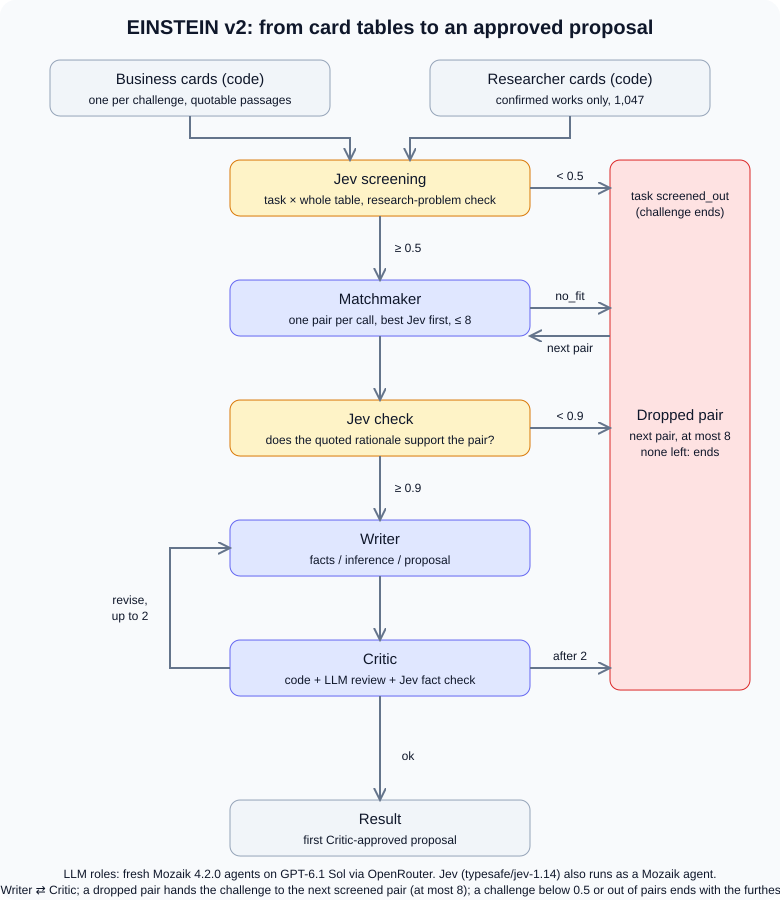

# EINSTEIN Matchmaker

Agents turn a company challenge into a source-linked researcher collaboration proposal. Three LLM roles run on Mozaik 4.2.0: Matchmaker, Writer and Critic. Jev (`typesafe/jev-1.14`, OpenRouter Decisions API) screens pairs, checks the Matchmaker's rationale and checks proposal facts; each Jev request runs as its own Pair Screener agent on Mozaik.

Up to `TASK_CONCURRENCY` challenges (default 3) are processed at the same time. LLM requests share one Mozaik runtime that admits at most `MAX_CONCURRENT` (default 4) at once and stops at `BUDGET_USD`; Jev requests run outside that limit (a challenge's screening batches in parallel) and their cost is journaled but not budgeted.

Route ([architecture as executed](docs/architecture.md), with the constants and files behind each step):

1. **Card tables (code).** A `BusinessCard` per challenge and a `ScholarCard` per researcher, built deterministically from the hash-checked dataset; only works with confirmed authorship are included.
2. **Jev screening.** Jev reads the task and the whole researcher table in batches and returns, per researcher, the probability that their methods address the task, plus the probability that the task is a research problem at all. Pairs below 0.5 are dropped.
3. **Matchmaker.** One pair per call, highest Jev probability first, at most 8 per task: a short fit decision, then a pair with rationale, constraints, risks and questions quoted from the dataset. Code checks every quote and its authorship.
4. **Jev check.** Jev judges whether the quoted rationale supports the pair, with the named risks in view; below 0.9 the pair is dropped.
5. **Writer ⇄ Critic.** Critic combines code checks, an LLM review and a Jev fact check; up to two revisions, then the pair is dropped.
6. **Result.** The first Critic-approved proposal ends the task. The only loop is Writer ⇄ Critic; a dropped pair hands the task to the next screened pair.

Task statuses: `ready`, `screened_out`, `no_fit`, `check_failed`, `proposal_needs_revision`, `limit_reached`, `execution_failed`; a task without a proposal reports the furthest stage any of its pairs reached.



The dataset is synthetic. A ready proposal means automated review completed; it does not establish participant consent or prove experimental outcomes.

## Results

From one run that processed three challenges at the same time, with Matchmaker, Writer and Critic on GPT-6.1 Sol ([submission/README.md](submission/README.md) has the details and the earlier DeepSeek runs):

| Challenge | Company | Researcher | Proposal |
|---|---|---|---|
| C001-CH1, anomaly detection on Modbus/BACnet without labelled attacks | ArmaturaSec d.o.o. | R1008 | [proposal](submission/2026-10-31T12-39-58-110Z/proposals/C001-CH1.md) |
| C009-CH1, search failing on Serbian inflection and mixed scripts | LinguaBot d.o.o. | R0349 | [proposal](submission/2026-10-31T12-39-58-110Z/proposals/C009-CH1.md) |
| C003-CH1, conveyor welds cracking in cold storage | AutomVoj a.d. | R0365 | [proposal](submission/2026-10-31T12-39-58-110Z/proposals/C003-CH1.md) |

- **Trace of the full run:** [trace.md](submission/2026-10-31T12-39-58-110Z/trace.md). 18 requests, $0.308, about 1 min 15 s, with the Jev screening loaded from cache. All three proposals passed the Critic on the first version, so this trace has no Critic intervention.
- **Trace with Critic interventions:** [`14-15-54`](submission/2026-10-31T14-15-54-356Z/trace.md), the same three challenges and pairs on the current code (`778c2a1`): the Critic blocked each first draft once with a `plan_underspecified` issue (C001: no statistical acceptance condition, and transitive alert merging would let an always-flagging detector pass; C009: the bank-only gate does not constrain the other query groups; C003: the reproduction gate could pass with indistinguishable conditions), the Writer revised its own draft and every second version was approved. The external reviewer confirmed all three interventions as justified, the quotes genuine and the conditions of each first draft preserved in the revision, but kept `12-39-58` as the main run because its first drafts set stricter targets (90% rather than 80% detection in C001, an overall <5% threshold in C009, a ≥25% improvement gate in C003): [review](submission/reviews/codex-review-run-2026-10-31T14-15-54.md). The earlier intervention in [`11-58-04`](submission/2026-10-31T11-58-04-042Z/trace.md) was a false Jev fact block and is kept as such.
- **Why the Critic changed on 31.10:** on the Writer's model the LLM layer of the Critic had raised one content issue in 32 reviews while an external reader found gaps in approved texts. Since `13db5ec` the Critic fills a ten-item checklist first, and a `pass` needs the proposal span that satisfies the item; since `778c2a1` the Writer revises its rejected draft instead of starting over. Calibration on six saved proposals (all three known gaps found, no invented quotes) and the two live runs are in [docs/critic-calibration.md](docs/critic-calibration.md).
- **Critic findings that changed a proposal:** in the earlier DeepSeek run, [event 32](submission/2026-10-31T09-46-59-649Z/trace.md) blocked a C009-CH1 draft that compared against a baseline "without script normalization" although the company said it had already tried one, and [version 3](submission/2026-10-31T09-46-59-649Z/artifacts/proposal-C009-CH1-R0349.v3.json) was approved; [event 26](submission/2026-10-31T09-46-59-649Z/trace.md) blocked a C001-CH1 draft that assumed live mirror-port access to a client network when the company had offered archives, a bench and firmware under NDA, and that pair was dropped.
- **Critic effect across the 16 bundled runs of the main route:** 49 `critic.revise` events on 34 proposal drafts; 27 of those drafts were approved in a later version and 7 pairs were dropped without an approved version. The eleven interventions of the three checklist-Critic runs on the main challenges were each confirmed as justified by the external reviewer.
- **Full run with cold Jev screening:** [`13-11-35`](submission/2026-10-31T13-11-35-673Z/) repeats the three challenges on `41933a2` with no screening cache: 21 Jev batch requests (3,144 questions) are in its [inference.jsonl](submission/2026-10-31T13-11-35-673Z/inference.jsonl), each screening and check artifact records the wording of its Jev questions, and each proposal Markdown ends with its evidence ledger. 3 × `ready` with the same three pairs, 39 requests, $0.396, 1 min 19 s. The reviewer confirmed all 52 quotes and the cold screening but kept `12-39-58` as the main run: the new C001 draft proposes 80% instead of 90% detection and a 5-minute instead of 60-second alert merge, and the new C003 draft drops the room-temperature loaded control ([review](submission/reviews/codex-review-run-2026-10-31T13-11-35.md)). Both runs are kept unchanged.
- **Critic on a second model, tried and reported:** on GPT-6.1 Sol the LLM layer of the Critic raised one content issue in 32 reviews, while the external reader found gaps in approved proposals, so the Critic got its own model route (`MODEL_CRITIC`) and two runs used DeepSeek V4.1 Flash for it: [`13-48-14`](submission/2026-10-31T13-48-14-687Z/) (3 × `ready`, $0.43; its one block of a C003 draft cited a company quote that does not exist, 2–5 °C where the record says 2–6 °C, and the reviewer confirmed the block was false: [review](submission/reviews/codex-review-run-2026-10-31T13-48-14.md)) and [`13-53-23`](submission/2026-10-31T13-53-23-732Z/) after the fix below (3 × `ready`, C009 with R0288 because R0349 scored 0.89 at the Jev check, 0 issues, $0.24). Neither improved on the main run, so `MODEL_CRITIC` defaults to the Writer's model and both runs are kept as they are. What stayed from the experiment: code now verifies the Critic's own quotes against the dataset exactly as it verifies the Writer's; an issue it cannot ground is recorded in the verdict as `unverifiedIssues` and does not block.
- **Ten unselected challenges:** drawn with a fixed seed and run unchanged, all outcomes kept. On the current code with the checklist Critic: 5 `ready`, 2 `proposal_needs_revision` (the Critic rejected three drafts in a row), 2 `check_failed`, 1 `screened_out` (not a research problem), 12 Critic interventions, $3.40, 15 minutes; on the earlier Critic 6 `ready` ($2.26); 4 `ready` on the earlier DeepSeek code. Details and the caveats in [submission/README.md](submission/README.md#sample-of-ten-unselected-challenges).
- **An honest refusal:** [C064-CH3](submission/2026-10-31T00-38-00-194Z/summary.json) asks for sales coaching; Jev rates it a research problem at 0.03, so it is `screened_out` instead of being forced into a pair.
- **External LLM review:** Codex `gpt-6-astra`, as a stand-in for a human reader, checked all 47 quotes of the three proposals against the dataset (all exact), judged that both sides would sit down over each, and rated all three `accept` with no required fixes: [review](submission/reviews/codex-review-run-2026-10-31T12-39-58.md). It does not replace review by the people involved.
- **Reverse search for EINSTEIN Stars:** see the next section.

## How this plugs into the EINSTEIN network and EINSTEIN Stars

**Network.** A technology-transfer coordinator at the University of Novi Sad or Science and Technology Park Novi Sad enters a challenge from a network company. The system returns source-linked proposals, open questions and the Critic's record; the coordinator reads them and decides whether to introduce the two sides. Nothing is sent to a company or researcher automatically. Partner universities (JKU Linz, WUR, DTU) could add their researchers as more researcher cards.

**EINSTEIN Stars** is the project's programme for PhD students and early-career researchers with industrial potential, which promises them industry contacts. `npm run stars` runs the route the other way: one researcher's full card (fields, bio, industry experience, confirmed works with abstracts) against all 489 company challenges, in Jev batches of at most 25 challenges and 96 KiB; a challenge is kept when Jev rates both "the methods address it" and "it is a research problem" at 0.5 or more. The first three kept challenges go through the same Matchmaker, Jev 0.9 check, Writer and Critic for that fixed pair. The output is a list of challenges for that person; the system never compares people or predicts winners.

```sh
RUN_SCHOLAR=R0349 npm run stars
```

Two runs, on researchers chosen before running ([submission/README.md](submission/README.md#reverse-search-for-einstein-stars)):

| Researcher | Kept of 489 | Checked in depth | Cost |
|---|---|---|---|
| R0349, computational linguistics | 17 | [C009-CH1](submission/stars-2026-10-31T12-43-03-800Z/proposals/C009-CH1.md) `ready`, [C132-CH4](submission/stars-2026-10-31T12-43-03-800Z/proposals/C132-CH4.md) `ready` (a challenge not in our main set, reviewed `accept` by the external reader), C114-CH2 `check_failed` | $0.32 |
| R0365, welding | 8 | [C003-CH1](submission/stars-2026-10-31T12-44-29-257Z/proposals/C003-CH1.md) `ready`, C086-CH4 and C068-CH2 `check_failed` | $0.21 |

The profiles are synthetic and whether these people would apply to Stars is not known. The Jev values are screening filters, not the probability that a project succeeds, and three attempts are not a full search.

We have no EINSTEIN or Stars API; the connector format and approval points have to be agreed with their owners. Cost and scale (one challenge $0.10–0.25, the whole dataset an estimated $50–120, and a company-level pre-filter for a larger network, measured on 15 challenges: no kept pair lost up to a threshold of 0.4): [docs/einstein-integration.md](docs/einstein-integration.md#cost-and-scale).


## Development

Use Node 24 or newer. Tested with Node 24.22.2; Vitest 5 does not run on the original Node 20.10 environment.

```sh
nvm use
npm ci --ignore-scripts
npm run check
npm run fetch-data
cp .env.example .env
```

Set `OPENROUTER_API_KEY` in `.env`, then run:

```sh
npm run smoke
RUN_TASKS=C001-CH1 npm start
RUN_TASKS=C001-CH1,C009-CH1,C003-CH1 npm start
RUN_TASKS=all TASK_CONCURRENCY=3 npm start   # every challenge in the dataset
scripts/bundle-run.sh runs/<run-id>          # copy a run into submission/ to commit it
```

`PREFILTER_THRESHOLD=0.4` turns on the optional company-level pre-filter before the challenge screening (off by default; [measurement](docs/company-prefilter-test.md)). `DATASET_DIR` overrides the default `data/data` path. Source hashes are checked against [the pinned manifest](docs/dataset-manifest.json). The default model for every LLM role is `openai/gpt-6.1-sol` (`MODEL_STRONG`; `MODEL_FAST` is not used by the current route); every role sends `medium` reasoning effort, and the inference journal records it. Earlier bundles used `deepseek/deepseek-v4.1-flash-1017`. A live transport smoke has passed. Full-run quality and failure results are recorded separately.

Output is written to ignored `runs/<run-id>/`: `summary.json`, `inference.jsonl`, workflow `trace.jsonl`, readable `trace.md`, measured `metrics.json`, immutable JSON artifacts and approved proposal Markdown. The Markdown links to its fact/evidence ledger. Failed runs and rejected versions are retained; validation repairs are distinguished from Critic interventions.

Jev screening results are cached per task in ignored `runs/screening/<dataset-version>/`, so a rerun does not screen the same task again.

Each run has a configurable monetary budget for chat-model calls; Jev costs (about $0.02 to screen one task against all 1,047 researchers) are journaled but not counted against it. Matchmaker content validation permits two corrections after its initial response, then the pair is dropped. A limit or technical failure never becomes PASS, and the first approved pair is not claimed to be the globally best one.

The default tests run offline. They exercise the actual Mozaik runtime with synthetic completion responses and do not evaluate live model quality. Provided dataset files belong in the ignored `data/` directory.

## Integration boundaries

`src/contracts/` is the common schema source. `RoleInference` does not allocate business artifact IDs, versions or Critic approvals. The workflow attaches authoritative `inputs`/`subject`, rejects stale approvals, enforces Writer admission and retains source-linked versions. A source error in one candidate is recorded separately; a network failure is not silently treated as candidate incompatibility.

Source handling and limits: [data use](docs/data-use.md). Proposed portal/coordinator workflow and an explicit connector boundary for Stars: [EINSTEIN integration](docs/einstein-integration.md). No undocumented Stars API or completed network connection is claimed.
