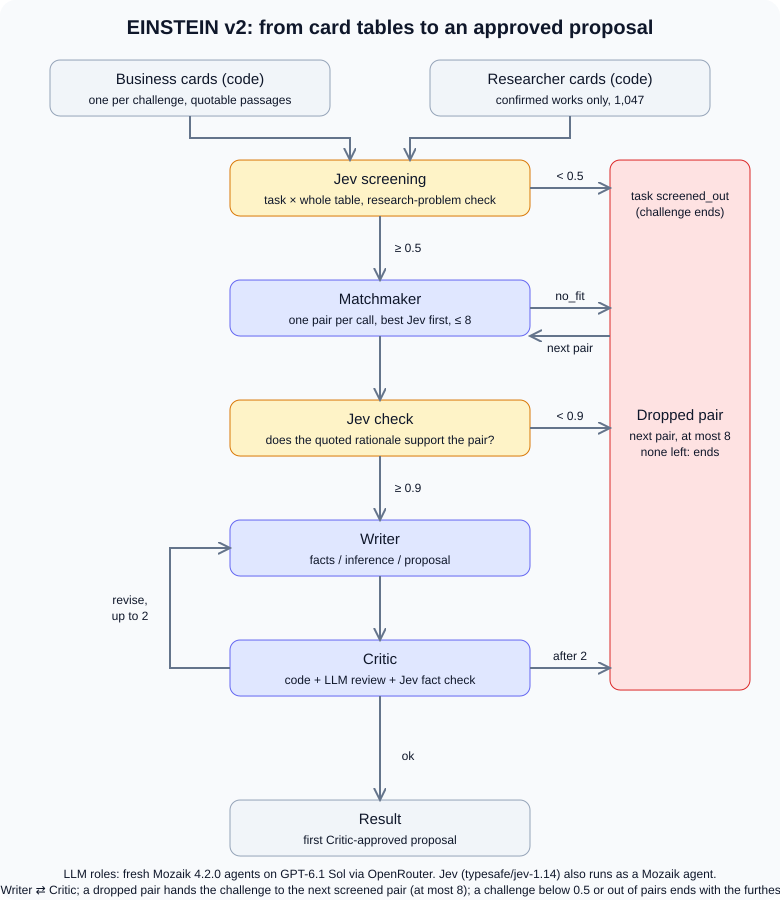

# Architecture as executed

This describes what `npm start` does on the current code. Every number below is a constant in the cited file.

## Agents and code steps

| Step | Who | Input | Output | Drop rule | Code |
|---|---|---|---|---|---|
| 1. Cards | code | hash-checked dataset | one `BusinessCard` per challenge, one `ScholarCard` per researcher (works with confirmed authorship only; willingness and availability from explicit phrases, with quotes) | none | `src/cards/` |
| 2. Screening | Jev 1.14 as a Mozaik agent (Pair Screener) | the challenge and a compact table of all 1,047 researchers (fields, keywords, up to 8 work titles), split into batches of 150; one yes/no question per researcher plus "is this a research problem" | `TaskScreening`: probability per researcher, kept if ≥ 0.5; research-problem probability; the wording of both Jev questions | task < 0.5 → `screened_out`; no researcher ≥ 0.5 → `screened_out` | `src/screening/screen-task.ts`, `src/app/create-stages.ts` (`SCREENING_BATCH_SIZE`) |
| 3. Matchmaker | LLM Mozaik agent | one challenge card and one scholar card | first a short fit decision, then a `PairAssessment` with rationale, constraints, risks and questions quoted from the dataset | `no_fit` → next pair; quotes, authorship and role refusals checked by code, up to 3 attempts | `src/features/matching/adapters/outbound/assess-pair.ts` |
| 4. Jev check | Jev as a Mozaik agent | the challenge, the quoted rationale and the Matchmaker's risks | `PairCheck` with the question wording, kept if ≥ 0.9 | < 0.9 → next pair | `src/screening/check-pair.ts` |
| 5. Writer | LLM Mozaik agent | both cards, the pair assessment, Critic or code feedback and, on a revision, its own rejected draft with the rule to keep every acceptance condition | `Proposal`: facts with quotes, inferences, potential benefits, proposed actions, questions | code checks quotes, a fact from the researcher's own work, every pair constraint, list items and limits | `src/features/proposals/adapters/outbound/write-proposal.ts` |
| 6. Critic | code + LLM Mozaik agent + Jev | the proposal, both cards, the company's original text and the cited sentences; the LLM fills a ten-item checklist whose `pass` needs the proposal span that satisfies the item | `CriticVerdict` with issues, LLM issues whose quotes code could not find (`unverifiedIssues`, never blocking) and Jev's support probability for every fact (`jevFactCheck`, with the question wording) | any blocking issue → back to Writer; after 3 Writer attempts → next pair (`proposal_needs_revision`) | `src/agents/critic/critique-proposal.ts` |
| 7. Result | code | the first approved proposal | Markdown ending with the evidence ledger (fact, record, field, quote), JSON artifacts, trace | the task stops at its first approved pair | `src/features/workflow/application/collaboration-workflow.ts` |

The Matchmaker sees at most 8 screened pairs per challenge, in Jev order (`MAX_CANDIDATES`). A dropped pair never returns work to an earlier role; the only loop is Writer ⇄ Critic, and a dropped pair hands over to the next screened pair. The status of a challenge without a proposal is the furthest stage any of its pairs reached: `screened_out`, `no_fit`, `check_failed`, `proposal_needs_revision`; technical failures are `limit_reached` or `execution_failed`.

## Concurrency and limits

- Up to `TASK_CONCURRENCY` challenges (default 3) run at the same time (`src/app/run.ts`).
- LLM requests share one Mozaik runtime that admits at most `MAX_CONCURRENT` (default 4) requests at once and stops at `BUDGET_USD` (`src/features/inference/adapters/outbound/mozaik-role-inference.ts`).
- Jev requests are not counted by `MAX_CONCURRENT`: the screening batches of a challenge (7 for 1,047 researchers) run in parallel, and the Critic's Jev fact check runs alongside the LLM review. Jev costs are journaled but not counted against `BUDGET_USD`.
- Each request has a deadline of `REQUEST_TIMEOUT_MS` (default 240 s); a cut-off or malformed answer of Matchmaker or Writer counts as one of that role's attempts, and a cut-off Critic review is asked once more. Jev requests have a fixed deadline of 180 s (`src/features/inference/adapters/outbound/openrouter-decision.ts`).

## Screening cache

Screening a challenge against all 1,047 researchers is the widest Jev step, so its result is stored in `runs/screening/<dataset-version>/<challenge>.json` and reused by later runs. A run that reuses the cache records in the screening artifact when the screening was made and that it came from the cache; its reported cost and time then exclude screening. A cold screening costs about $0.02 per challenge (measured on ten challenges: $0.19).

## Models

Matchmaker and Writer use `MODEL_STRONG`, the Critic `MODEL_CRITIC` (defaults to `MODEL_STRONG`; two runs with DeepSeek V4.1 Flash there are in the submission bundle) (default `openai/gpt-6.1-sol`, `medium` reasoning effort sent explicitly). Screening, the pair check and the Critic's fact check use `typesafe/jev-1.14` through the OpenRouter Decisions API. Earlier bundles used `deepseek/deepseek-v4.1-flash-1017`; why the model changed is in [submission/README.md](../submission/README.md).
